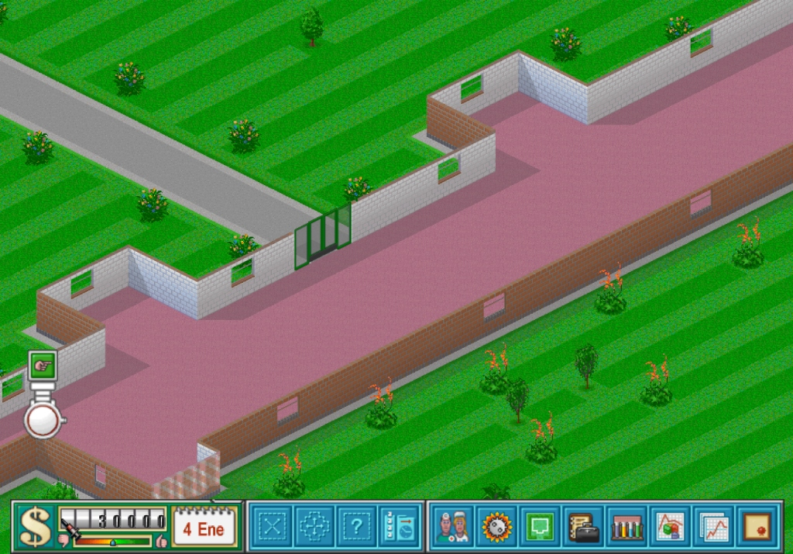
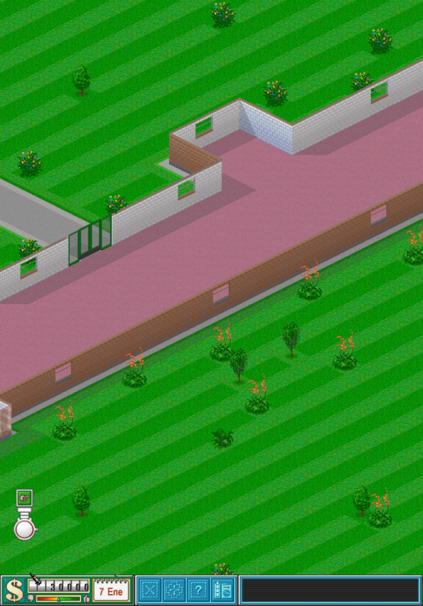

# Theme Hospital
### Native iPadOS & iOS Port (`arm64`)

> *"Hospital administrator is needed in GP's office."*

<p align="center">
  <a href="https://github.com/CorsixTH/CorsixTH"></a>
  
  
  
  <a href="https://www.buymeacoffee.com/margelenders"></a>
</p>

| Landscape Orientation | Portrait Orientation |
| :---: | :---: |
| <br><sub><em>Native widescreen hospital view in Landscape</em></sub> | <br><sub><em>Full hospital overview in Portrait</em></sub> |

A native touch port of **Theme Hospital** for **iPadOS and iOS** on Apple Silicon (`arm64`), built on top of the modern open-source [CorsixTH](https://github.com/CorsixTH/CorsixTH) engine.

Runs at native 60 FPS with hardware-accelerated **Metal / SDL3** graphics, full multi-touch gesture navigation (pan, pinch-to-zoom, contextual right-clicks), adaptive UI scaling for both iPads and iPhones, native iPadOS Files app save-game integration, and an all-in-one automated Mac setup assistant.

---

> [!NOTE]
> **Fork of CorsixTH:** This repository is an independent platform port of the [CorsixTH/CorsixTH](https://github.com/CorsixTH/CorsixTH) project. All original game simulation rules, patient AI, room logic, and medical machinery logic come from the extraordinary decade-long effort of the CorsixTH team. This fork extends the engine with native UIKit/Metal integration, touch controls, device auto-scaling, and a zero-friction iOS deployment pipeline.

---

## 🌟 Highlights & Features

- **100% Native Apple Silicon Execution:** Native `arm64` binary compiled directly with Clang and CMake. Rendered via Metal and SDL3 with smooth 60 FPS frame pacing and low battery consumption.
- **Natural Multi-Touch Controls:**
  - **1-Finger Drag:** Effortlessly pan the hospital camera across rooms and corridors.
  - **2-Finger Pinch:** Responsive, fluid zoom in and zoom out across the entire hospital layout.
  - **2-Finger Tap (TipTap):** Secondary action (right-click) to instantly cancel object placement or dismiss open inspection windows.
  - **Direct Touch Interaction:** Tap doctors, nurses, handymen, and patients to inspect status, grab them, or reassign them.
- **Adaptive UI & Multi-Device Scaling:**
  - High-resolution rendering for iPad Pro, iPad Air, and iPad mini.
  - Native 3x layout scaling and adaptive bottom toolbar for iPhones and compact screens.
  - Seamless support for both **Landscape** and **Portrait** orientations.
- **Seamless iPadOS Files App Integration:**
  - Saves, configuration, and custom levels are stored in your device's standard Documents container (`On My iPad → CorsixTH → Saves`).
  - Easily back up, transfer, or edit save files with the native Files app.
- **High-Fidelity Audio & Music:**
  - Bundled high-quality `GeneralUser-GS` soundfont for rich, authentic Roland Sound Canvas MIDI soundtrack playback.
- **Zero-Friction 1-Click Setup:**
  - Built-in automated macOS wizard (`Install_Theme_Hospital.command` or `./setup.sh`) that checks prerequisites, unpacks your GOG installer, compiles dependencies, configures Apple code signing, and deploys directly to your iPad.

---

## 📋 Prerequisites

To compile and install the game on your iPad or iPhone:

1. **Mac Computer:** Running macOS Ventura, Sonoma, Sequoia, or newer.
2. **Xcode 15+:** Installed from the Mac App Store or Apple Developer portal.
   - Command Line Tools installed: `xcode-select --install`
3. **CMake:** Installed via Homebrew (`brew install cmake`) or downloaded from [cmake.org](https://cmake.org).
4. **Theme Hospital Game Data:** A legally acquired copy of the original Theme Hospital from [GOG.com](https://www.gog.com/game/theme_hospital) (the offline Mac `.pkg` or Windows `.exe` installer).
5. **iPad or iPhone:** Running iPadOS / iOS 16 or newer with **Developer Mode** enabled (*Settings → Privacy & Security → Developer Mode*).

---

## 🚀 Quick Start (Automated Setup)

Clone this repository to your Mac:

```bash
git clone https://github.com/MargeLenders/ThemeHospital-ipad.git
cd ThemeHospital-ipad
```

Then choose either option:

### Option A: 1-Click in Finder
1. Open the project folder in Finder.
2. Double-click **`Install_Theme_Hospital.command`**.
3. Follow the friendly interactive instructions in the Terminal window that opens.

### Option B: From Terminal
```bash
./setup.sh
```

---

### What the Setup Wizard Does Automatically

1. **Tooling Verification:** Checks for Xcode Command Line Tools, CMake, and Python 3 (installs CMake automatically via Homebrew if missing).
2. **Game Asset Extraction (*Heavy Lifting*):**
   - Automatically detects your downloaded Theme Hospital installer in `~/Downloads` or prompts you to **drag and drop** the installer file into the Terminal.
   - Transparently unpacks macOS `.pkg` packages, `.dmg` images, or Windows Inno Setup `.exe` installers.
   - Automatically downloads the high-quality `GeneralUser-GS.sf2` soundfont for authentic MIDI music.
3. **Engine Third-Party Dependencies:**
   - Prepares and patches SDL3, SDL3_mixer, Lua 5.4, LuaFileSystem, LPeg, zstd, libpng, and FreeType under `ios/third_party/`.
4. **Target Selection & Deployment:**
   - **Connected iPad/iPhone:** Auto-detects your connected physical device, detects your Apple Development signing certificate from the macOS Keychain, compiles the signed app, and installs it onto your device.
   - **Mac iPad Simulator:** Launches the iPad Simulator in landscape mode and starts the game immediately without needing cables or device pairing.

---

## 🎮 Touch Controls Quick Reference

| Gesture | Action |
|:---|:---|
| **1-Finger Drag** | Pan the hospital camera across the facility |
| **2-Finger Pinch** | Zoom in and zoom out smoothly |
| **1-Finger Tap** | Select patient, staff, object, or button |
| **2-Finger Tap** | Right-click action: cancel placement, close open dialog |
| **Drag & Drop** | Pick up doctors, nurses, or handymen and drop them where needed |

---

## 📱 First-Time Launch on iPadOS

If deploying with a free personal Apple ID:
1. When you first tap the Theme Hospital icon on your iPad, iPadOS may display an *"Untrusted Developer"* dialog.
2. On your iPad, navigate to:  
   **Settings → General → VPN & Device Management**
3. Under **Developer App**, tap your Apple ID email.
4. Tap **Trust "[Your Apple ID]"** and confirm.
5. Return to your Home Screen and launch **Theme Hospital**.

---

## 💾 Save Games & iPadOS Files App

Your game data and progress are stored in your iPad's user-accessible Documents directory:
- Open the native **Files** app on iPadOS.
- Navigate to: **On My iPad → CorsixTH**
  - **`Saves/`**: Your game saves (compatible with desktop CorsixTH).
  - **`config.txt`**: Game settings (resolution, audio volume, language).
  - **`HOSP/`**: Original game assets.

---

## 🛠️ Advanced / Manual Commands

If you prefer building and managing the project manually from the command line:

```bash
# 1. Extract game assets from a GOG installer
./scripts/extract_theme_hospital.py /path/to/theme_hospital_installer.pkg

# 2. Prepare iOS third-party dependencies
./scripts/prepare_ios_deps.sh

# 3. Build & run on iPad Simulator
./scripts/run_ios_simulator.sh --landscape

# 4. Build & deploy to a connected physical device
CORSIXTH_IOS_DEVELOPMENT_TEAM="YOUR_TEAM_ID" ./scripts/build_ios_debug.sh --device
./scripts/deploy_ios_device.sh
```

---

## 🚦 Status & Compatibility

| Subsystem | Status | Notes |
|:---|:---|:---|
| **Campaign & All 12 Levels** | ✅ Fully Working | Complete single-player campaign playable from level 1 to level 12. |
| **Touch Controls & Gestures** | ✅ Fully Working | 1-finger pan, 2-finger pinch zoom, 2-finger tap right click. |
| **Graphics & Fullscreen** | ✅ Fully Working | Native resolution rendering with Metal acceleration (60 FPS). |
| **Audio & MIDI Music** | ✅ Fully Working | Sound effects and MIDI soundtrack with bundled SoundFont. |
| **Save & Load** | ✅ Fully Working | Native iOS dialogs and direct integration with iPadOS Files app. |
| **iPadOS Experience** | ✅ Excellent | Optimized for 11-inch, 12.9-inch, 13-inch, and mini iPads. |
| **iPhone Experience** | ✅ Playable | Adaptive 3x scaling and compact bottom toolbar. |

---

## ❓ Frequently Asked Questions (FAQ)

#### Does this require a paid Apple Developer account?
No. Free Apple IDs (Personal Teams) are supported. Apps signed with free personal accounts remain valid on the device for 7 days, after which running the setup script or building again refreshes the profile.

#### Can I play on the Mac Simulator without an iPad?
Yes! Simply run `./setup.sh` and choose option `2) On the Mac iPad Simulator`.

#### Are original game assets included in the repository?
No. To respect Electronic Arts and Bullfrog copyright, proprietary Theme Hospital assets (`DATA`, `LEVELS`, graphics, and audio) are not included. The setup assistant extracts them directly from your legally purchased GOG installer.

---

## ☕ Support the Project

If you appreciate the effort put into bringing **Theme Hospital** natively to iPadOS and enjoy playing it on Apple Silicon, consider buying me a coffee to support future updates and maintenance!

<p align="center">
  <a href="https://www.buymeacoffee.com/margelenders" target="_blank">
    
  </a>
</p>

---

## 🤝 Upstream & Acknowledgements

This port is proudly based on the open-source **[CorsixTH](https://github.com/CorsixTH/CorsixTH)** project.

- **Upstream Repository:** [https://github.com/CorsixTH/CorsixTH](https://github.com/CorsixTH/CorsixTH)
- **Official Website:** [https://corsixth.com](https://corsixth.com)
- **Original License:** MIT License

Sincere gratitude to the entire CorsixTH team, original creators Peter "Corsix" Cawley and Edvin "Lego3249" Cabek, and the hundreds of contributors who have kept Theme Hospital alive and thriving on modern platforms.

---

## ⚖️ Legal Disclaimer

Theme Hospital is a registered trademark of Electronic Arts Inc. This project is an independent educational, open-source reimplementation port and is not affiliated with, endorsed by, or sponsored by Electronic Arts Inc. or Bullfrog Productions. Game assets must be legally acquired from authorized vendors such as [GOG.com](https://www.gog.com/game/theme_hospital).
